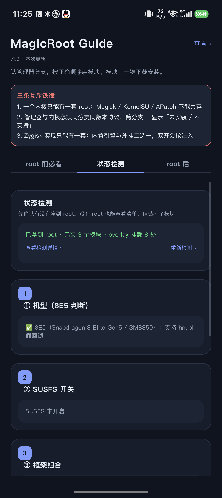

# MagicRoot Guide (RootGuide)

> An Android root toolbox: device/root state inspection, module checklist with one-tap install,
> risk-control (anti-detection) scanning, one-tap framework recovery, and continuous reboot-log capture.

[简体中文](README.md) | English



**Current version v1.21 (versionCode 22)**. Verified on HONOR Magic8 Pro (Android 17, SukiSU-Ultra, kernel 6.12.58).

> ⚠️ **Disclaimer**: this project performs root operations, framework injection, system property and kernel module changes. It may brick your device, cause boot loops, or lead to data loss. It is intended for **technical study** and on **devices you own** only. Back up before use. Use at your own risk.

## Features

| Area | What it does |
|---|---|
| **Manager detection** | Detects which `su` manager you actually run (Magisk / KernelSU / SukiSU / APatch / FinaSU …) from runtime evidence, then lists the settings and modules that branch needs |
| **State check** | Root state, SoC/model, SUSFS switch, framework combination (LSPosed / Vector / Zygisk variants), module and manager integrity, reverse-anomaly checks |
| **Risk-control scan** | Runs leak checks an app could actually perform (props, package names, file traces, mounts, kernel, its own `maps`/`status`), merged "risky app" list, and one-tap **export** of package names for HMA / HMA-OSS / FuseFixer blocklists |
| **Framework recovery** | One-tap repair for LSPosed / Vector: cleans stale daemons and locks, starts the monitor and daemon **from the module directory** (required for `framework.dex` / `bridge` relative paths), waits for the daemon to be ready, then restarts zygote |
| **Reboot-log capture** | Streaming collection with per-item `flush + fsync`, so nothing is lost if the device reboots mid-capture. Uses shell first and **switches to `su` automatically** once root is detected; results land in `Download/RB-log/` |
| **Background survival** | Foreground service + notification + optional floating window (auto-collapses when idle), so collection keeps running in the background |

## Requirements

- JDK 17
- Android SDK with compileSdk 35
- A device on Android 8.0 (API 26) or newer; root is optional (some features degrade gracefully)

## Build

The repository does not include `local.properties`, `build/`, or APK artifacts.

```bash
git clone https://github.com/small1ee/MagicRoot-Guide.git
cd MagicRoot-Guide
echo "sdk.dir=/path/to/Android/sdk" > local.properties
./gradlew :app:assembleDebug
# output: app/build/outputs/apk/debug/app-debug.apk
```

## Where data is stored

- Reboot logs: `Download/RB-log/reboot_log_<timestamp>.txt`
  (Android 10+ writes through MediaStore, so no storage permission is needed; Android 9 and below falls back to the legacy public directory)
- Each item is flushed and `fsync`-ed immediately after collection, and action markers such as
  `[动作 2026-11-06 01:15:30] 用户触发一键修复框架（lsposed）` are appended so a reboot can be matched to what you did right before it.

## Notes on scope

- Reading kernel (`dmesg`), system `logcat`, pstore and vendor reliability logs **requires root**. Without root, any Android app can only read world-readable files such as `boot_id`, `/proc/cmdline`, `/proc/uptime` and sysfs gate values.
- The risk-control scanner implements the checks that can be reproduced on-device; the full 135-item catalogue is shipped as a document for reference.

## License

- **Code**: MIT, see [LICENSE](LICENSE).
- **Bundled third-party documents / data** (Chunqiu detection solutions, the hnubl manual, LSPosed / Vector related material, etc.): copyright belongs to the original authors, see [NOTICE.md](NOTICE.md). If you are an original author and want something removed, please open an issue.

---

For the detailed Chinese documentation (architecture, per-feature rationale, changelog) see [README.md](README.md) and [CHANGELOG.md](CHANGELOG.md).
