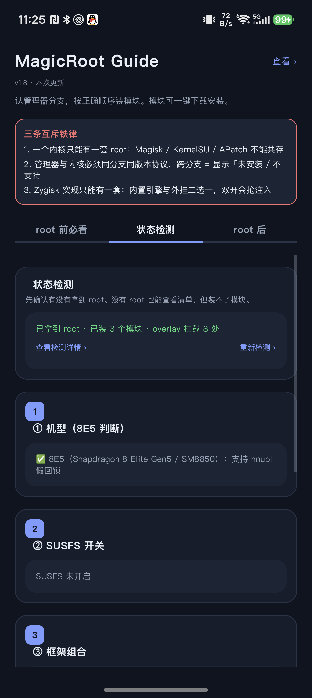

# MagicRoot Guide（RootGuide）

> 面向 Android Root 用户的工具箱：状态检测、模块清单与一键安装、风控环境检测、框架一键修复、重启日志持续采集。
> 自动识别你**实际在用**的 su 管理器分支，给出「设置项 + 模块」清单，点一下自动下载并安装。



**当前版本 v1.20（versionCode 21）**，在荣耀 8K（Magic8 Pro / Android 17 / SukiSU-Ultra）真机验证。

> ⚠️ **免责声明**：本项目涉及 root、框架注入、系统属性与内核模块操作，可能导致设备变砖、无限重启或数据丢失。仅供**技术学习**与**自有设备**调试，操作前请备份。使用风险自负。

## 快速开始

环境：JDK 17、Android SDK（compileSdk 35）。仓库不含 `local.properties`、`build/` 与 APK 产物。

```bash
git clone https://github.com/small1ee/MagicRoot-Guide.git
cd MagicRoot-Guide
echo "sdk.dir=/path/to/Android/sdk" > local.properties
./gradlew :app:assembleDebug
# 产物：app/build/outputs/apk/debug/app-debug.apk
```

## 许可

- **代码**：MIT，见 [LICENSE](LICENSE)。
- **内置第三方文档/数据**（春秋检测项解决方案、hnubl 手册、LSPosed/Vector 相关资料等）：版权归原作者，来源见 [NOTICE.md](NOTICE.md)。如原作者有异议，请开 issue 删除。

---

> 说明：下文「一 ~ 七」保留 v1.8 时期的技术细节；v1.9 ~ v1.20 的功能与修复见 [CHANGELOG.md](CHANGELOG.md)。

## 一、这一版做了什么

| 能力 | 说明 |
|---|---|
| **自动识分支** | 打开即探测，不用点按钮。实测在这台机器上识别为 **FinaSU**（HIGH 置信度）。识别到就收起下拉框，只留「不是这个？手动选」；**没 root 或证据不足才要求手选**，并在状态行写清楚原因 |
| **查看指南** | 标题右侧「查看」→ App 内直接读网页版《安卓 Root 使用者指南》（内置 35 KB HTML，免登录、离线可看）；页内右上「在线打开」跳线上最新版 |
| **两块参考** | su 管理器选型决策图 / Root 注意事项速览图，内置 SVG（WebView 渲染，双指放大）；手选分支时还有「不确定选哪个？」直达选型图 |
| **引导设置项** | 探测结果下方直接给出「接下来要改的设置项」，随分支与运行时状态变化 |
| **点一下装模块** | 卡片上的「下载并安装」→ 查官方仓库最新 Release → 下载 → 落盘 → `ksud/magisk/apd` 安装 → 显示输出 |
| **已装识别** | 读 `/data/adb/modules`，已装的模块标「● 已装」，按钮变「重新安装」 |
| **软重启/重启** | 清单页底部一键生效（锁 BL 的机器必须用软重启） |
| **参考图自适应** | 竖屏铺满宽度、横屏整张放进一屏，旋转立即重排；右上「放大」约 2 倍查看密排文字 |
| **铁律置顶** | 三条互斥铁律做成红色描边横幅，进门第一眼就看见 |
| **图标与名称** | 自适应图标（盾牌 + `>_`），名称 `root使用指南` |

已移除：临时 root 一键诊断页（`DiagnoseActivity` / `DiagChecks` / `DiagScript` / `activity_diagnose.xml` / `rootdiag.sh`）。
Web 版 `Root模块引导.html` 里的诊断 Tab 仍保留，未动。

## 二、自动识别是怎么认的

**结论先行：管理器包名不可靠，文件指纹才可靠。**

实测反例（本机）：内核是 FinaSU，但装的管理器包名是 `com.resukisu.resukisu` —— FinaSU 从 ReSukiSU 分叉时沿用了上游包名。只按包名认，这台机器就会认错。

所以判据分两级：

| 级别 | 判据 | 置信度 |
|---|---|---|
| 强 | `/data/adb/ksu/bin/folkzygisk` 存在；`ksud` 子命令含 `zygisk`/`sui`/`boot-hide`/`uts-view`/`netisolate`；`/data/adb/ksu/folksu-susfs` 存在 | **HIGH**（命中 ≥2 条即认定 FinaSU） |
| 弱 | 管理器包名（`me.weishu.kernelsu` / `com.rifsxd.ksunext` / `com.sukisu.ultra` / `com.resukisu.resukisu` / `com.anatdx.yukisu` / `com.topjohnwu.magisk` / `me.bmax.apatch` …） | **MEDIUM**（会提示"需你确认"） |
| — | 都没有 | **NONE**：不猜，强制手选 |

认不出时**故意不猜**：不同分支的 `needMetaModule` 取值可能完全相反，猜错会让用户装错东西（FinaSU 装元模块 = 双挂载，轻则模块失效重则 bootloop）。

除分支名外，还会读运行时事实并把它们翻译成「设置项」：

- `mount_runtime` 的 `provider` → builtin（别装元模块）/ external（要装）
- `folkzygisk` 存在 → 已内置 Zygisk，别装 Zygisk Next
- 内置引擎与外挂 Zygisk 模块**同时存在** → 提示只保留一套（本机实测命中了这一条）
- `mount_mode` → 建议保持 automatic

## 三、安装

```
adb install -r RootGuide-v1.8-debug.apk
```

或传到手机点开安装（需允许「未知来源」）。debug 签名，非发布版。

## 四、代码结构

```
app/src/main/java/com/sean/rootguide/
├── Branches.kt        12 个分支定义 + Step/StepKind 数据模型
├── BranchDetect.kt    分支指纹采集脚本 + 判定（强/弱证据分级，认不出不猜）
├── RootProbe.kt       跑指纹 → 生成人类可读结论 + 「设置项」引导
├── Insets.kt          edge-to-edge 补偿（targetSdk 35 强制，不加标题会被状态栏压住）
├── PlanBuilder.kt     按分支生成「设置项 + 模块」清单（顺序 = 安装顺序）
├── ModuleCatalog.kt   可下载模块清单：repo + 资产正则 + 已装别名
├── ModuleInstaller.kt Release 解析 / 下载 / 落盘 / 安装命令分派
├── SuExec.kt          su -c 执行层（并发读流，避免大输出死锁）
├── MainActivity.kt    启动即探测 + 分支选择（自动/手选两态）+ 引导展示
├── Links.kt           指南与参考图的地址、内置资源、打开方式（单一来源）
├── RefViewActivity.kt 内置 html/svg 查看页（WebView + 窄屏覆盖样式 + 在线打开）
├── Changelog.kt       「本次更新」纯文本（App 内弹窗）
├── PlanActivity.kt    清单 + 一键下载安装编排（单线程串行）+ 软重启/重启
├── StepAdapter.kt     卡片渲染（类型标签 / 已装 / 状态行 / 三个按钮）
├── ModuleInstallActivity.kt  手动安装已下载的 zip（兜底路径）
└── Prefs.kt           分支、进度、已装模块缓存
```

### 模块下载为什么不在代码里写死链接

Release 资产名带版本号 + commit 短哈希（如 `Zygisk-Next-1.5.2-864-a4a72ce-release.zip`），写死必过期。
所以运行时走 `https://api.github.com/repos/<repo>/releases/latest` 现查，用正则挑资产：

| 模块 | 仓库（2026-10-29 实测） | 资产匹配 | 类型 |
|---|---|---|---|
| meta-overlayfs | `KernelSU-Modules-Repo/meta-overlayfs` | `*.zip` | 模块 |
| Zygisk Next | `Dr-TSNG/ZygiskNext` | `*release.zip` | 模块 |
| Zygisk Assistant | `snake-4/Zygisk-Assistant` | `*release.zip` | 模块 |
| PlayIntegrityFork | `osm0sis/PlayIntegrityFork` | `*.zip` | 模块 |
| Tricky Store | `5ec1cff/TrickyStore` | `*release.zip` | 模块 |
| Vector | `JingMatrix/Vector` | `*release.zip` | 模块 |
| Hide My Applist | `Dr-TSNG/Hide-My-Applist` | `*.apk` | 插件 |
| AdAway | `AdAway/AdAway` | `*.apk` | 插件 |

KPM / SUSFS 没有统一分发渠道（SUSFS 在 GitLab 且必须与内核补丁配套），如实标「模块 · 手动获取」，不假装能一键装。

安装命令按体系分派：

```
KernelSU 系 / 临时 root → ksud module install "<path>"
Magisk 系               → magisk --install-module "<path>"
APatch 系               → /data/adb/ap/bin/apd module install "<path>"
APK（插件）             → pm install -r "<path>"
```

### 落盘这一步为什么不能省

App 进程写不了 `/data/local/tmp`（属 `shell:shell`）。所以先下到 App 私有 `cacheDir`，
再用 **root** `cp` 到 `/data/local/tmp/rg_<ts>_<name>`：root 读得到 App 私有目录，
而 `ksud` 在自己的 SELinux 域里读 App 数据可能被拒。这一步不做，安装会因读不到文件而失败。

## 五、构建

### 本机工具链（已装好，可复用）

| 组件 | 位置 | 来源 |
|---|---|---|
| JDK 17.0.14 (Zulu) | `/Users/sean/.local/jdk/zulu17.56.15-ca-jdk17.0.14-macosx_x64` | `cdn.azul.com` 官方 tar.gz |
| Gradle 8.9 | `/Users/sean/.local/gradle/gradle-8.9` | 腾讯云镜像（`services.gradle.org` 本机不通） |
| 最小 Android SDK | `/Users/sean/.local/android-sdk`（platform-35 + build-tools 35.0.1） | `dl.google.com` 直连 zip |

```bash
./build.sh                        # → RootGuide-v1.8-debug.apk（版本号从 build.gradle.kts 读）
adb install -r RootGuide-v1.8-debug.apk
```

`build.sh` 做三件事：① 探测 JDK/Gradle/SDK（两套历史路径都认）② 复制到 `/tmp` 再构建（绕开工作区删除保护）③ 把 `https_proxy` 透传给 Gradle（JVM 不读 shell 环境变量）。

两个坑：

1. **不要用 `./gradlew`** —— `distributionUrl` 指向不可达的 `services.gradle.org`。
2. **Gradle 必须显式代理** —— `gradle.properties` 的 `systemProp.https.proxyHost/Port`，端口随会话变。

### 版本组合（勿随意升）

AGP 8.7.3 / Gradle 8.9 / Kotlin 2.0.21 / compileSdk 35 / targetSdk 35 / minSdk 26
依赖：core-ktx 1.13.1、appcompat 1.7.0、material 1.12.0、recyclerview 1.3.2、constraintlayout 2.1.4

## 六、真机验证记录（2026-10-29，荣耀 BKQ-AN10 / Magic8 Pro）

| 项 | 结果 |
|---|---|
| 自动识别 | 体系 KernelSU → 分支 **FinaSU ✅ 自动识别**，5 条依据全部命中 |
| 运行时事实 | 挂载引擎 builtin；管理器包名 `com.resukisu.resukisu`；假回锁（locked + green + 持久化 ksud） |
| 引导设置项 | 5 条，含「内置 FolkZygisk 与外挂 zygisk_lsposed/zygisk_vector/zygisksu 同时存在，只保留一套」 |
| 清单 | 13 项（4 必装），已匹配 2 项「已装」 |
| 下载并安装 | AdAway 实测：解析 v6.1.4 → 下载 13.9 MB → 落盘 `/data/local/tmp`（root:root 644）→ `pm install` 成功 → 卡片显示 ✅ 安装完成 并自动勾选 |
| 模块安装命令 | 自建空模块验证 `ksud module install` → `Module installed successfully!`，模块目录生成，测后已删除，现有 7 个模块未受影响 |
| 图标/名称 | `application-label:'root使用指南'`，自适应图标正常渲染 |

### v1.7 验证（2026-10-29，同机 · 资源同步 · 历史）

| 项 | 结果 |
|---|---|
| 版本 | `versionName=1.7` / `versionCode=8`，覆盖安装成功，分支与进度记录保留 |
| 首页 | 铁律横幅在顶部、四段卡片带序号徽章、状态行「已拿到 root · FinaSU · 已装 7 个模块 · overlay 挂载 8 处」 |
| 选型决策图 | 红色「临时 root」框与左侧 Q2 选项不再重叠；新增「30 秒测出来」框在手机上文字清晰、未溢出 |
| 注意事项图 | NO.05 标题为「临时 root 不是一种分支」，与指南口径一致 |
| 图页缩放 | 「放大 ›」→ 约 2 倍，可读密排文字；再点变「适应屏幕」→ 整幅回落，来回切换无错位 |
| 指南页 | 新增「先分清楚两件事」说明块正常渲染；0 速查表按窄屏换行、无横向溢出；页脚为 `v1.2 ｜ 2026-10-29` |
| 内置资源 | `guide.html` 27 KB / `branch_map.svg` 10 KB / `precautions.svg` 10 KB，全部离线可读 |

> 测试过程中点「在线打开」会跳到浏览器并落到需登录的页面（未登录状态可能显示开通/支付页）。这是外链本身的行为，不是 App 的问题；日常看内容用内置那份即可。

### v1.2 验证（2026-10-29，同机 · 历史）

| 项 | 结果 |
|---|---|
| 首页结构 | 环境准备 / 管理器分支 / 开始 / 参考 四段，一屏内可看到前三段 |
| 自动识别 | 启动即显示「已自动识别：FinaSU」（绿），下拉框收起，保留「不是这个？手动选」 |
| 手选联动 | 点「不是这个？」→ 下拉展开分支列表；切换后说明卡与设置项同步变化，不残留上一个分支的建议（v1.4 起下拉已去掉「临时 root」，它是手段不是分支） |
| 查看 | 标题右侧「查看 ›」→ App 内渲染指南页，表格按窄屏换行、不横向溢出；右上「在线打开 ›」跳浏览器 |
| 参考图 | 两张 SVG 均正常渲染、垂直居中、可双指放大；点卡片进查看页，返回正常 |
| 计划页 | 「生成设置项与模块清单」→ FinaSU · 13 项，无回归 |
| 更新日志 | 标题下「v1.2 · 本次更新」→ 纯文本弹窗，分组齐全 |
| 无 root 路径 | **未做破坏性验证**（真机 root 正常）。代码路径：`hasRoot=false` → 状态行「没检测到 root 环境，请手动选择管理器分支」+ 直接给下拉框 |

### v1.8 验证（2026-10-29，同机 · 修「未授权被报成没 root」）

真机状态：FinaSU 管理器已装（`me.yuki.fina`，label `FinaSU` v1.3.2），但 `超级用户` 列表是 0 个，
本 App 没有被授权 —— 正是这条要修的误报。

| 项 | 结果 |
|---|---|
| 修复前 | 首页报「没检测到 root 环境（无 su、无管理器）」，分支区块要求手选 |
| 修复后 | 「检测到 FinaSU，但本 App 未获 root 授权」；分支区块「系统已 root，但本 App 未获授权，请确认分支：FinaSU」 |
| 诊断详情 | `su 可执行文件：/product/bin/su`、`已装管理器：me.yuki.fina（FinaSU）`、`su 调用：exit=127，stderr=su: 内核接口未允许执行 /system/bin/su` |
| 引导区 | 标题变「先给本 App 授权」，4 条按 FinaSU 白名单模型写 |
| 去管理器授权 | 点击直接拉起 `me.yuki.fina/me.weishu.kernelsu.ui.MainActivityDefault`，实测跳转正常 |
| 已授权路径 | 代码未改采集逻辑，仅补 `su -c` 失败时走 stdin 重试；**本轮未在本 App 上验证到授权态**（需用户在管理器里加白名单） |

## 七、风险与边界

- 只安装**你点的那一个**模块；不批量、不自动挑、不改 boot/init_boot/vendor 分区。
- 依赖 GitHub API（未认证 60 次/小时）。限流或网络不可达时会明确报错并引导去「仓库」手动下载，不静默失败。
- 装错模块仍可能 bootloop：自救先 `touch /data/adb/modules/<id>/disable`，再逐级排查。
- 模块请只从官方 GitHub Releases 获取；第三方整合包是投毒重灾区。
